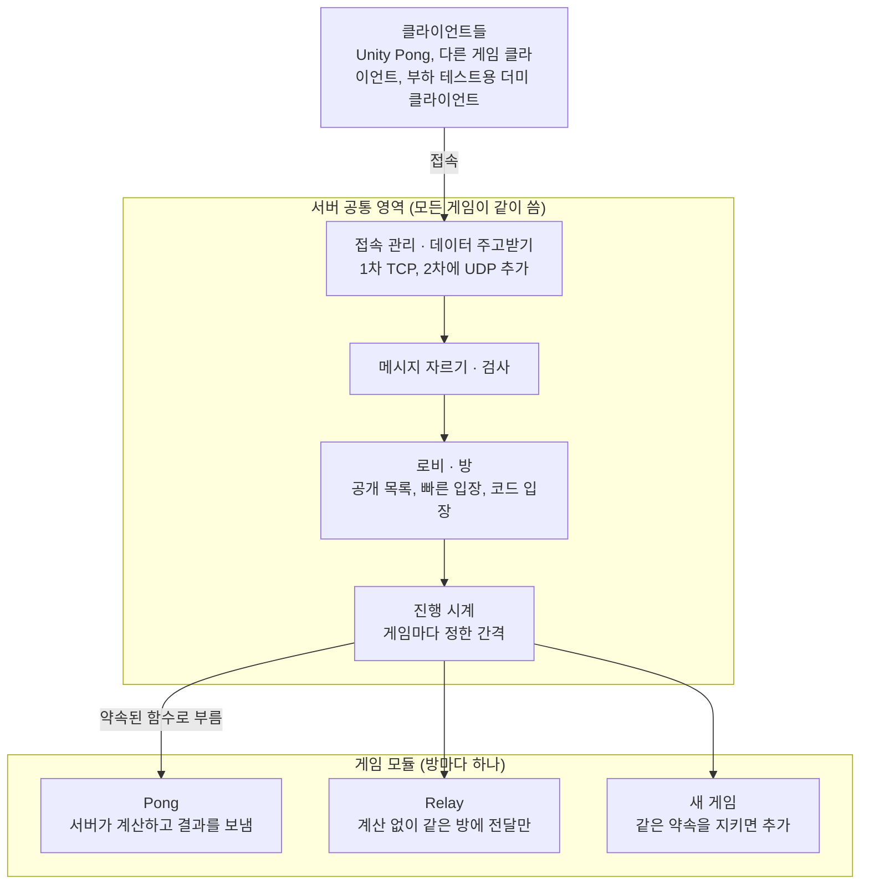
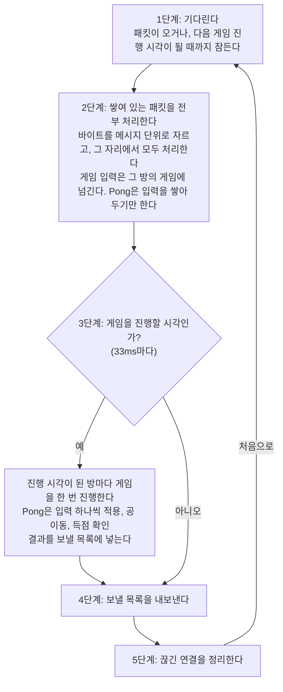
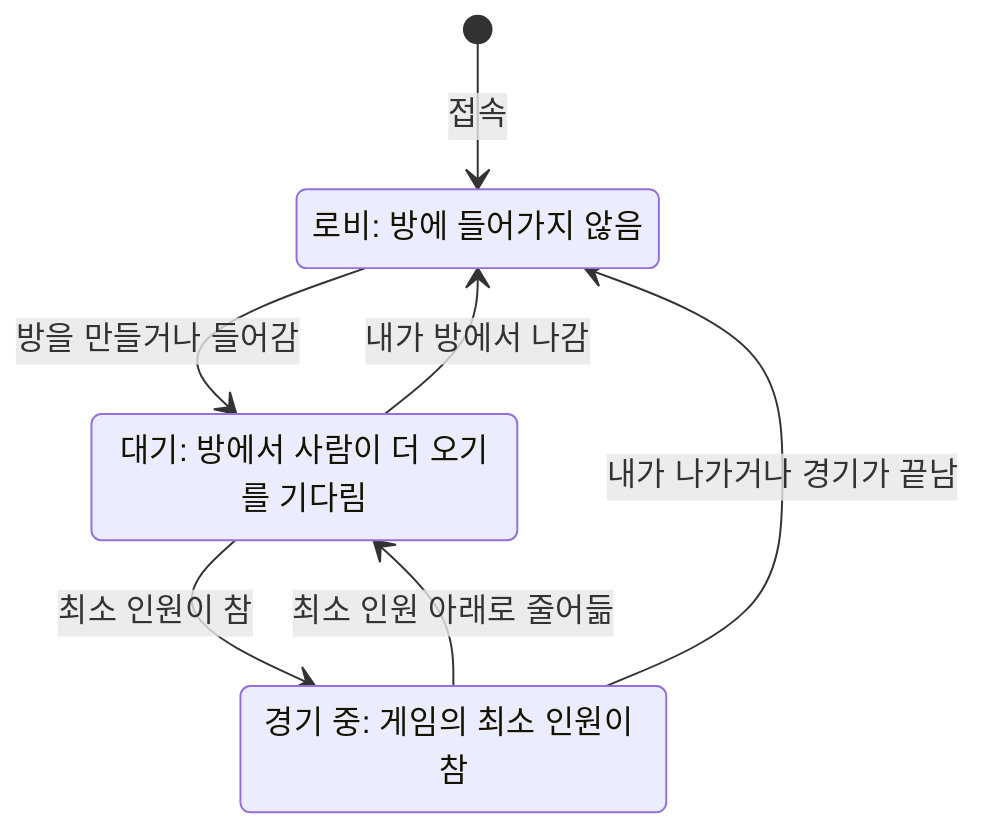
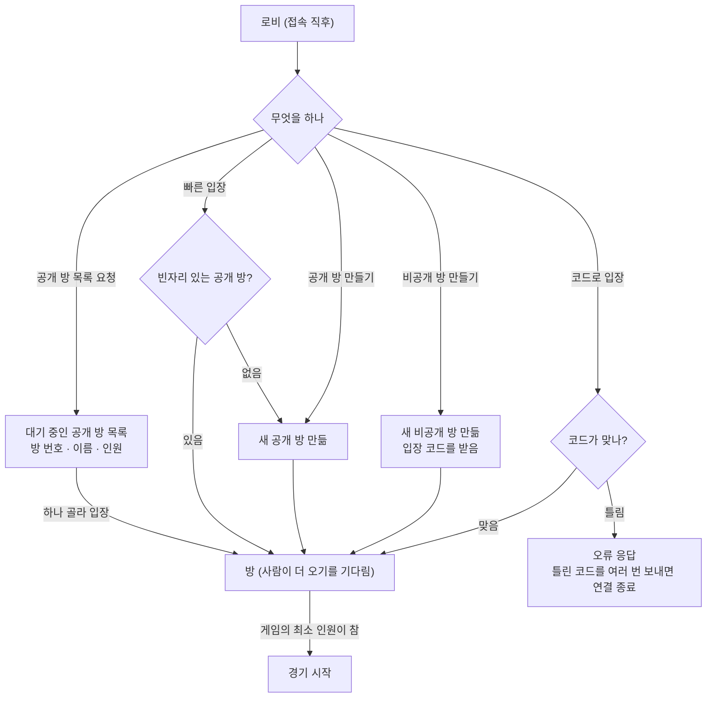

# 시스템 개요

> 상태: 초안 (2026-11-21). 이 문서는 무엇을 왜 만드는지와 큰 구조를 정한다. 바이트 단위 규칙은 [protocol.md](protocol.md)가, 되돌리기 어려운 결정의 근거는 [adr/](adr/)가 맡는다.

## 1. 무엇을 만드는가

C로 작성한 리눅스 게임 서버 하나와, 그 서버에 접속해 2인 대전을 하는 Unity Pong 클라이언트.

서버는 **공통 영역**과 **게임 모듈**로 나뉜다.

1. **공통 영역(코어)**: 접속, 메시지 자르기와 검사, 로비, 방 만들기 · 입장 · 퇴장, 진행 시계. 어떤 게임이든 그대로 쓴다.
2. **게임 모듈**: 방마다 하나를 고른다. 코어가 정한 약속(인터페이스)만 지키면 코어를 고치지 않고 붙는다. 이번에 만드는 것은 두 개다.
   - **Pong**: 서버가 30Hz로 경기를 계산하고 결과를 두 플레이어에게 보낸다(권위적 서버). 클라이언트는 입력만 보낸다.
   - **Relay**: 서버는 계산하지 않고, 받은 데이터를 같은 방의 다른 사람에게 전달만 한다. 클라이언트 하나가 게임을 계산하는 방식의 게임이 쓴다.

## 2. 왜 만드는가

- 소켓, epoll 이벤트 루프, 바이너리 패킷 처리를 외부 네트워크 라이브러리 없이 바닥부터 구현한다(README의 의존성 원칙).
- 만든 서버가 실제로 쓸 만한지 숫자로 보인다: 동시 접속 수, 틱 유지, 지연 분포.
- 코드는 AI가 작성하고, 사람은 설계 결정 · 검증 · 측정 해석을 맡는다. 단계마다 자동 테스트와 직접 플레이로 결과를 확인한다.

## 3. 목표 · 비목표 · 반목표

**목표**

- Unity 클라이언트 두 개가 서버를 거쳐 끝까지 Pong 한 판을 할 수 있다(서로 다른 네트워크에서도).
- 방 여러 개가 동시에 진행되고, 한 서버에서 서로 다른 게임(Pong, Relay)의 방이 함께 돌아간다.
- 새 게임은 공통 영역 코드를 고치지 않고 게임 모듈 하나와 protocol.md 6장의 절 하나로 붙는다.
- 깨진 패킷, 갑작스러운 끊김, 읽지 않는 클라이언트가 와도 서버가 죽지 않는다.
- 부하 테스트로 처리 한계와 지연(p50/p95/p99)을 측정해 보고서로 남긴다.

**비목표** (이번 범위에서 하지 않는다)

- 실력 기반 매치메이킹, 로그인, 계정, 랭킹 (방 입장 방식은 공개 로비와 비공개 코드 방 두 가지만 둔다, 6.5절)
- NAT 통과 (서버가 공인 IP를 가진다)
- 여러 서버로 확장(샤딩, 로드 밸런싱)
- 지연 보상(lag compensation)

**반목표** (동작하더라도 실패로 본다)

- 구조체를 통째로 `send`하는 등 플랫폼에 따라 결과가 달라지는 직렬화
- 같은 PC에서만 동작하는 구현(메시지가 쪼개지거나 붙어서 오면 깨지는 수신 코드)
- 읽지 않는 클라이언트 하나가 서버 메모리를 끝없이 늘리는 구조
- 측정 조건 없이 적은 성능 수치

## 4. 전체 구성



| 구성 요소 | 위치 | 언어 · 환경 |
|---|---|---|
| 서버 공통 영역 | `server/src/` | C11, Linux(epoll). 외부 라이브러리는 uthash만 |
| 공통 영역 · 게임 약속 | `server/src/game_api.h` | 게임 모듈이 구현할 함수 표와 코어가 주는 보내기 함수 |
| 게임 모듈 | `server/src/games/` | `pong.c`, `relay.c` |
| Unity 클라이언트 | `client-unity/` | Unity 6000.3.10f1, C# `System.Net.Sockets`. 서버와 같은 구조로 공통 부분(접속 · 로비)과 게임 부분(Pong)을 나눈다 |
| 더미 클라이언트, 측정 도구 | `tools/` | C11 |
| 테스트 | `tests/` | C11 단위 테스트, 서버를 띄워서 하는 통합 테스트 |
| 문서 | `docs/` | 이 문서, protocol.md, adr/, report.md |

## 5. 핵심 결정

| 결정 | 선택 | 이유 | 기록 |
|---|---|---|---|
| 전송 계층 | 1차: TCP + `TCP_NODELAY`로 전부 보낸다. 2차(일정이 되면): 로비 · 방 · 득점 같은 꼭 도착해야 하는 메시지는 TCP에 두고, 입력과 게임 상태만 UDP로 옮긴 뒤 둘을 같은 조건에서 측정해 비교한다 | TCP만으로 먼저 끝까지 완성해 일정 위험을 줄인다. 패킷 손실 때 TCP가 만드는 지연(07 예제: 5% 손실에서 p95 69ms → 216ms)을 UDP로 줄일 수 있는지 직접 재서 보고서에 넣는다 | [adr/0001-transport.md](adr/0001-transport.md) |
| 동기화 모델 (Pong) | 권위적 서버 + 상태 전송. Relay 게임은 서버가 계산하지 않는다 | README의 "권위적 상태 동기화" 목표. 클라이언트가 공 위치를 정하지 못하므로 두 화면의 결과가 갈라지지 않는다 | 이 문서, protocol.md 6장 |
| 진행 간격 | 게임마다 정한다. Pong은 30Hz | Pong에는 충분하고, 2인 방의 메시지량(초당 약 120개)이 작다. 측정 후 바꿀 수 있다 | protocol.md 6.1절 |
| 좌표 표현 | 정수(경기장 단위 좌표) | C와 C#의 계산 결과가 정확히 같아진다. `float`는 컴파일러 · CPU마다 미세하게 달라질 수 있다 | protocol.md |
| 직렬화 | 길이 접두사 프레임, 필드 단위 big-endian | 메시지 경계를 되찾고, 언어 · 플랫폼과 무관하게 같은 바이트가 된다 | protocol.md |
| 게임 확장 구조 | 공통 영역과 게임 모듈을 나누고, 게임은 정해진 함수 표(`game_def`)만 구현한다. 프로토콜도 공통 메시지와 게임 메시지(`GAME_IN` · `GAME_OUT`, 내용은 게임이 정함)로 나눈다 | 로비 · 방 · 접속은 어떤 게임에나 같다. Pong을 코어에 박으면 다른 게임마다 코어를 고쳐야 한다. 같은 서버에서 서버 계산 방식(Pong)과 전달만 하는 방식(Relay)을 둘 다 돌리고 부하를 비교할 수 있다 | [adr/0002-game-interface.md](adr/0002-game-interface.md) |
| 이벤트 루프 | 스레드 1개, epoll 레벨 트리거 | 동기화(락)가 없고, 디버깅이 쉽다. 목표 규모(동시 접속 1,000명대)에 충분하다 | 이 문서 |

## 6. 서버 내부 구조

### 6.1 모듈

**공통 영역 (코어)**

| 모듈 | 하는 일 |
|---|---|
| `main` | 인자 처리(`--port`), 시그널, 메인 루프 |
| `net` | 리스닝 소켓 생성, 소켓 옵션(`SO_REUSEADDR`, `TCP_NODELAY`, `O_NONBLOCK`). 2차에서 UDP 소켓 추가 |
| `conn` | 연결 테이블, 연결별 수신 버퍼와 송신 버퍼, 송신 버퍼 상한, 끊긴 연결의 지연 정리 |
| `loop` | epoll 등록 · 대기 · 이벤트 분배, `EPOLLOUT` 켜고 끄기 |
| `wire` / `frame` | 정수 읽기 · 쓰기, 프레임 파서(누적 버퍼에서 완성된 프레임만 꺼냄), 메시지 인코더 |
| `session` | 연결 상태(로비 · 대기 · 경기 중), 상태별 허용 메시지 검사, 공통 메시지 처리 |
| `room` | 방 목록(uthash, `room_id → room`), 공개 목록 · 빠른 입장 · 입장 코드, 경기 시작 · 끝, 게임 모듈 호출 |
| `channel` | 게임이 고른 보내기 방식(신뢰 · 비신뢰)을 실제 전송으로 바꾼다. 1차는 둘 다 TCP, 2차는 비신뢰만 UDP. `game_host`의 보내기 함수가 이 모듈로 들어온다 |
| `games` | 등록된 게임 목록(`game_id → game_def`) |
| `tick` | 단조 시계(`CLOCK_MONOTONIC`), 누산기, 한 번에 따라잡는 틱 수 상한. 진행 간격이 다른 게임도 각자 시계를 가진다 |
| `stats` | 틱 처리 시간, 버린 틱, 접속 수, 송수신 바이트 집계 |

**게임 모듈** (`server/src/games/`, 각자 `game_def` 하나를 내놓는다)

| 모듈 | 하는 일 |
|---|---|
| `pong` | 입력 큐(플레이어별 최대 4개), 한 번 진행(패들 → 공 → 충돌 → 득점), 상태 · 득점 메시지 만들기. 진행 함수는 순수 함수에 가깝게 두어 단위 테스트한다 |
| `relay` | 받은 데이터 앞에 보낸 사람 자리 번호를 붙여 방의 다른 사람에게 보낸다. 상태를 저장하지 않는다 |

**공통 영역과 게임 모듈 사이의 약속** ([server/src/game_api.h](../server/src/game_api.h))

| 방향 | 함수 | 하는 일 |
|---|---|---|
| 코어 → 게임 | `match_create` · `match_destroy` | 경기 시작 때 경기 상태를 만들고, 끝날 때 지운다 |
| 코어 → 게임 | `on_join` · `on_leave` | 경기 중 들어오고 나간 사람 (Relay처럼 중간 입장이 되는 게임) |
| 코어 → 게임 | `on_input` | 받은 `GAME_IN` 하나. 형식이 틀리면 음수를 돌려주고, 코어가 그 연결을 끊는다 |
| 코어 → 게임 | `on_tick` | 진행 한 번. 진행 간격이 있는 게임만 |
| 게임 → 코어 | `send` · `broadcast` | 한 명 또는 여러 명에게 `GAME_OUT`. 신뢰 · 비신뢰를 고른다 |
| 게임 → 코어 | `match_over` | 경기를 끝낸다. 코어가 결과를 알리고 방을 닫는다 |

게임 정의에는 이 밖에 `game_id`, 이름, 최소 · 최대 인원, 진행 간격, 입력 길이 상한이 들어 있다. 새 게임을 붙이는 일은 이 표의 함수를 구현하고, 등록 목록에 한 줄 넣고, protocol.md 6장에 페이로드 형식을 적는 것이다.

### 6.2 메인 루프

서버는 스레드 하나가 아래 다섯 단계를 끝없이 반복한다. 바퀴는 33ms마다 도는 것이 아니라 **패킷이 오면 바로** 돈다. 한 바퀴는 보통 1ms도 걸리지 않는다. 33ms(1/30초) 간격은 3단계의 게임 진행에만 적용된다.



| 단계 | 왜 이렇게 하나 | 코드에서는 |
|---|---|---|
| 1 기다린다 | 할 일이 없을 때 CPU를 쓰지 않는다. 다음 게임 진행 시각이 되면 패킷이 없어도 깨어난다 | `epoll_wait`, 타임아웃 = 다음 틱까지 남은 ms(올림) |
| 2 받은 패킷 처리 | TCP는 메시지 경계가 없어서 받은 바이트를 쌓아 두고 완성된 메시지만 꺼낸다. 공통 메시지(로비 · 방)는 코어가 처리하고 바로 답한다. 게임 입력은 게임 모듈에 넘긴다 | `recv` → 수신 버퍼 → 프레임 파서. 상태에 맞지 않는 메시지는 거부. 게임 입력은 `on_input` |
| 3 게임 진행 | 진행 간격이 일정해야 두 플레이어 화면이 같은 속도로 움직인다. 서버가 잠깐 멈춰서 늦었으면 밀린 칸 수만큼 몰아서 진행하되, 한 번에 몰아 하는 수에 상한을 둔다. Relay처럼 진행 간격이 없는 게임은 이 단계가 없다 | 고정 틱 루프(누산기), `on_tick` |
| 4 내보내기 | 상대가 느려 한 번에 다 못 보내면 나머지를 들고 있다가 다음 바퀴에 마저 보낸다 | 송신 버퍼, `EPOLLOUT` |
| 5 정리 | 끊긴 연결을 처리 도중에 바로 지우면, 같은 바퀴에서 그 연결에 결과를 보내려다 지운 메모리를 건드린다. 그래서 바퀴 끝에 몰아서 지운다 | 종료 표시 → 방에서 빼기 → `close` → `free` |

예: Pong 방에서 클라이언트 A와 B가 33ms마다 입력을 하나씩 보낼 때.

| 시각 | 일어난 일 | 서버가 하는 일 |
|---|---|---|
| 0ms | 게임 진행 시각 | 3단계: A, B 입력 큐에서 하나씩 꺼내 한 번 진행, 결과 전송 |
| 9ms | A의 입력 7번 "위" 도착 | 바로 깨어나 2단계: A 큐에 넣음 |
| 14ms | B의 입력 5번 "아래" 도착 | 바로 깨어나 2단계: B 큐에 넣음 |
| 25ms | C(로비)의 공개 방 목록 요청 도착 | 바로 깨어나 2단계: 목록을 바로 답함 |
| 33ms | 게임 진행 시각 | 3단계: A 7번 "위", B 5번 "아래"를 꺼내 한 번 진행 |

입력은 도착할 때마다 바로 받아 두고, 진행할 때 플레이어마다 하나씩만 쓴다. 큐가 비면 직전 입력을 다시 쓰고, 4개를 넘으면 가장 오래된 것을 버린다(protocol.md 6.1절). 패킷을 33ms마다 하나씩 꺼내 처리하면 안 된다. 그러면 로비 응답까지 늦어지고, 처리하지 못한 패킷이 계속 쌓인다.

### 6.3 연결 상태

접속한 클라이언트 하나하나는 아래 세 상태 중 하나에 있다. 상태에 따라 받아 주는 메시지가 다르다. 예를 들어 방에 들어가지 않은 사람이 보낸 게임 입력은 거부한다. 몇 명이 모여야 경기가 시작되는지는 게임이 정한다(Pong 2명, Relay 2명).



어느 상태에서든 **연결이 끊기거나 규칙에 어긋난 메시지를 보내면** 그 연결은 종료 표시가 되고, 메인 루프 5단계에서 방에서 빠진 뒤 지워진다. 남은 인원이 최소 인원보다 적어지면 경기가 끝나고 남은 사람은 "대기"로 돌아간다.

| 그림 이름 | 코드 이름 | 받아 주는 메시지 (protocol.md 4장 이름) |
|---|---|---|
| 로비 | `LOBBY` | `LIST_ROOMS`, `CREATE_ROOM`, `QUICK_JOIN`, `JOIN_ROOM`, `JOIN_BY_CODE`, `PING` |
| 대기 | `IN_ROOM` | `LEAVE_ROOM`, `PING` (`GAME_IN`은 버림) |
| 경기 중 | `PLAYING` | `GAME_IN`, `LEAVE_ROOM`, `PING` |
| (종료 표시) | `CLOSING` | 없음. 5단계에서 정리 |

위반했을 때의 처리(오류 응답 또는 연결 종료)는 protocol.md 5.4절에 있다.

### 6.4 자원 상한 (기본값, 측정 후 조정)

| 항목 | 기본값 | 넘으면 |
|---|---|---|
| 프레임 페이로드 최대 길이 | 512바이트 | 헤더를 읽는 즉시 연결 종료 |
| 연결당 수신 버퍼 | 2KB | 위와 같음(최대 프레임보다 크게 잡는다) |
| 연결당 송신 버퍼 | 64KB(스냅샷 약 30초 분량) | 느린 클라이언트로 보고 연결 종료 |
| 동시 접속 | `ulimit -n` 범위 안 | 새 접속을 받자마자 닫음 |
| 방당 인원 | 게임이 정한다 (Pong 2명, Relay 최대 8명) | `ERROR(ROOM_FULL)` |
| 무입력 시간 | 정하지 않음(TCP 끊김 감지에 맡김) | 필요해지면 protocol.md에 추가 |

### 6.5 방 만들기와 입장

방은 두 종류다. 방을 만들거나 빠른 입장을 할 때 어떤 게임의 방인지(`game_id`)를 고른다. 방 번호(`room_id`)는 항상 서버가 정한다. 클라이언트가 임의의 번호를 골라 남의 방에 들어가지 못하게 하기 위해서다.

| | 공개 방 | 비공개 방 |
|---|---|---|
| 만드는 법 | 공개 방 만들기 요청 | 비공개 방 만들기 요청 |
| 다른 사람에게 보이나 | 공개 로비 목록에 나온다 | 목록에 나오지 않는다 |
| 들어가는 법 | 목록에서 골라 입장, 또는 빠른 입장(빈자리가 있는 공개 방에 자동 배정, 없으면 새로 만듦) | 만든 사람이 받은 입장 코드를 친구에게 알려 주고, 친구가 그 코드로 입장 |
| 입장 코드 | 없음 | 서버가 만든 6자리 코드. 헷갈리는 글자(0 · O · 1 · I)를 뺀 대문자와 숫자. 방이 사라지면 코드도 사라진다 |



- 목록은 사람을 기다리는 공개 방만 보여 주고, 한 번에 32개까지 보낸다(응답 한 프레임이 최대 페이로드 512바이트 안에 들어가게).
- 코드는 추측해서 맞히기 어렵게 무작위로 만들고, 한 연결이 틀린 코드를 5번 보내면 끊는다.
- 메시지 이름 · 필드는 protocol.md 4–5장에 있다.

## 7. 클라이언트 동작

Unity 클라이언트도 서버와 같은 원칙으로 나눈다.

| 부분 | 하는 일 | 다른 게임에서 |
|---|---|---|
| 공통 부분 (C#) | 접속, 프레임 자르기 · 만들기, `WELCOME` · 로비 · 방 메시지 처리, `PING`으로 지연 측정, 로비 화면 | 그대로 쓴다 |
| 게임 부분 (C#) | `GAME_IN`을 만들고 `GAME_OUT`을 해석한다. Pong은 입력 전송, 상태 보간, 화면 | 게임마다 새로 만든다 |

- **수신**: 백그라운드 스레드가 소켓에서 바이트를 받아 프레임으로 자르고, 메시지를 스레드 안전 큐에 넣는다. Unity 메인 스레드는 `Update`에서 큐를 비운다. Unity API는 메인 스레드에서만 부른다.
- **입력 (Pong)**: `MATCH_START`를 받은 뒤 33ms마다 입력을 하나씩 보낸다. 입력이 바뀌지 않아도 보내고, 1부터 늘어나는 순서 번호를 붙인다.
- **표시 (Pong)**: 받은 상태를 버퍼에 쌓고, 현재 시각보다 약 100ms 과거 시점을 두 상태 사이에서 보간해 그린다(07 문서의 보간 방식).
- **예측 · 재조정 (Pong)**: 일정이 남으면 내 패들만 예측한다. 서버가 상태마다 "이번 진행에 쓴 내 입력 번호"(`last_input_seq`)를 보내므로 그 번호 뒤의 입력만 다시 적용하면 된다.

## 8. 검증 방법

| 단계 | 무엇으로 확인하나 |
|---|---|
| 모듈 | 단위 테스트: 프레임 파서(1바이트 조각 · 무작위 조각 · 거부 케이스), Pong 한 번 진행과 입력 큐 규칙, 방 입장 · 퇴장 · 경기 시작 조건, Relay 전달 |
| 서버 전체 | 통합 테스트: 서버를 띄우고 더미 클라이언트로 (1) Pong 방에 2명이 들어가 **같은 상태를 받는지**, 한쪽이 끊기면 상대가 대기로 돌아가는지 (2) Relay 방에 3명이 들어가 한 명이 보낸 데이터를 나머지 둘만 받는지 (3) Pong과 Relay 방이 동시에 돌아가는지 |
| 견고성 | 무작위 바이트 · 잘못된 헤더 · 읽지 않는 클라이언트 · 강제 종료를 넣어도 서버가 살아 있고 메모리가 늘지 않는지 |
| 메모리 | 모든 테스트를 AddressSanitizer/UBSan 빌드로 돌려 보고 0 |
| 데모 | 사람이 Unity 창 두 개로 직접 플레이 |
| 성능 | 더미 클라이언트로 접속 수를 늘리며 틱 처리 시간, 버린 틱, RTT 분포를 기록 |

빌드와 테스트는 Docker의 `gcc:14` 이미지에서 돌린다(Windows에서 epoll을 쓸 수 없기 때문).

```powershell
docker run --rm -v "C:/GitHub/Relay Server Practice:/src" -w /src gcc:14 sh -c 'make clean all && make test'
```

## 9. 측정 계획

- **환경**: 개발 PC의 Docker(같은 기계), Oracle Cloud Always Free Micro 인스턴스(VM.Standard.E2.1.Micro, 1/8 OCPU 기본 + 버스트, 메모리 1GB, 인터넷 대역폭 최대 50Mbps).
- **지표**: 동시 접속 수별 틱 처리 시간(p50/p95/p99/최대), 버린 틱 수, 입력부터 그 입력이 반영된 스냅샷 수신까지의 시간 분포, 서버 메모리.
- **기록 원칙**: 모든 수치에 표본 수, 측정 시간, 환경(기계, 빌드 옵션, 같은 기계 여부)을 같이 적는다.
- **임시 목표**: 동시 접속 1,000명(방 500개)에서 30Hz 유지, 버린 틱 0. Micro의 CPU가 작아서 이 목표는 첫 측정 후 다시 정한다.

## 10. 일정 (2026-11-20 기준, 마감 12-06까지 16일)

| 기간 | 할 일 | 끝났다는 기준 |
|---|---|---|
| 11/21 | protocol.md, 공통 영역 · 게임 약속(`game_api.h`), `server/` 뼈대, Makefile | 서버가 뜨고 접속을 받는다. protocol.md 승인 |
| 11/22–11/24 | 서버: 이벤트 루프, 프레임, 로비 · 방, 진행 시계, Pong · Relay 게임 모듈 | 더미 클라이언트 통합 테스트(Pong · Relay) 통과, ASan 보고 0 |
| 11/25–11/28 | Unity 클라이언트: 접속, 입장, 입력, 보간 표시 | 창 두 개로 대전이 된다 |
| 11/29–11/30 | 견고성: 끊김, 송신 버퍼 상한, 깨진 패킷 | 견고성 테스트 통과 |
| 12/01–12/02 | 2차: 입력 · 게임 상태를 UDP로 (11/28까지 Unity 대전이 될 때만) | UDP로 대전이 되고, TCP와 UDP를 서버 옵션으로 바꿀 수 있다 |
| 12/03–12/05 | Micro 배포, 부하 테스트(TCP와 UDP 비교 포함), report.md | 다른 네트워크에서 플레이, 측정 표 |
| 12/06 | 발표 준비 | v1.0 |

**밀릴 때 버리는 순서**: 클라이언트 예측 → UDP 추가(TCP만으로 보고서 작성) → 보간(받은 스냅샷을 그대로 그림) → 부하 테스트 규모 축소.

## 11. 남은 결정

| 항목 | 정할 곳 | 정하는 사람 |
|---|---|---|
| protocol.md 초안 승인 (특히 6.1절 Pong 규칙 수치, 5.4절 오류 코드) | protocol.md | 사람 |
| 데모 서버로 기존 `tetris-relay` Micro를 쓸지 새 Micro를 만들지 | 배포 시점 | 사람 |
