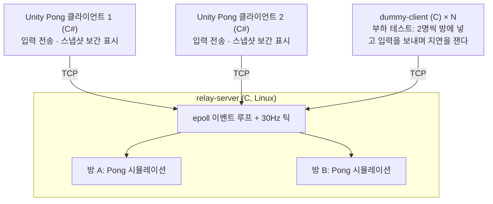
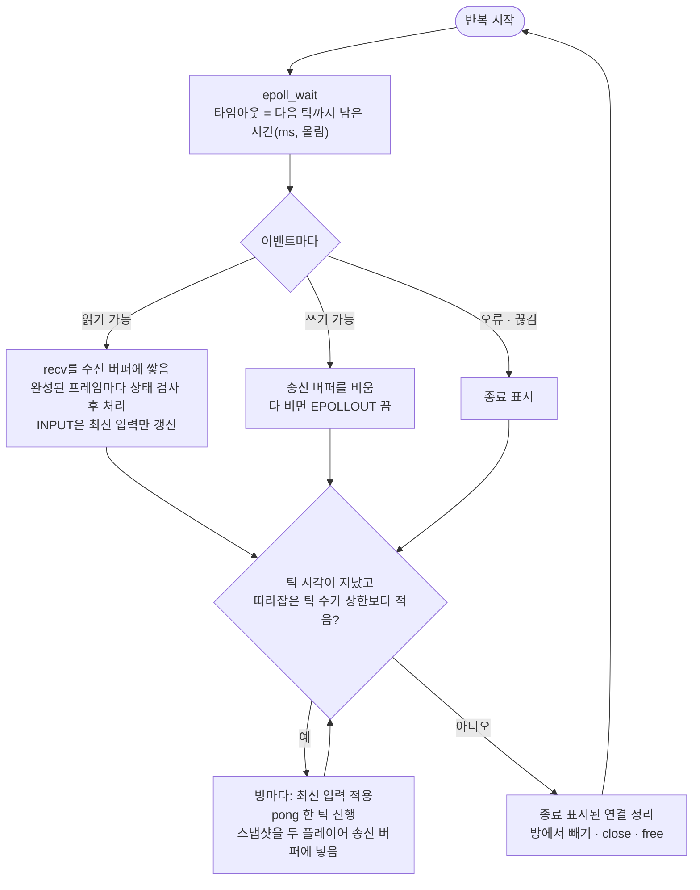
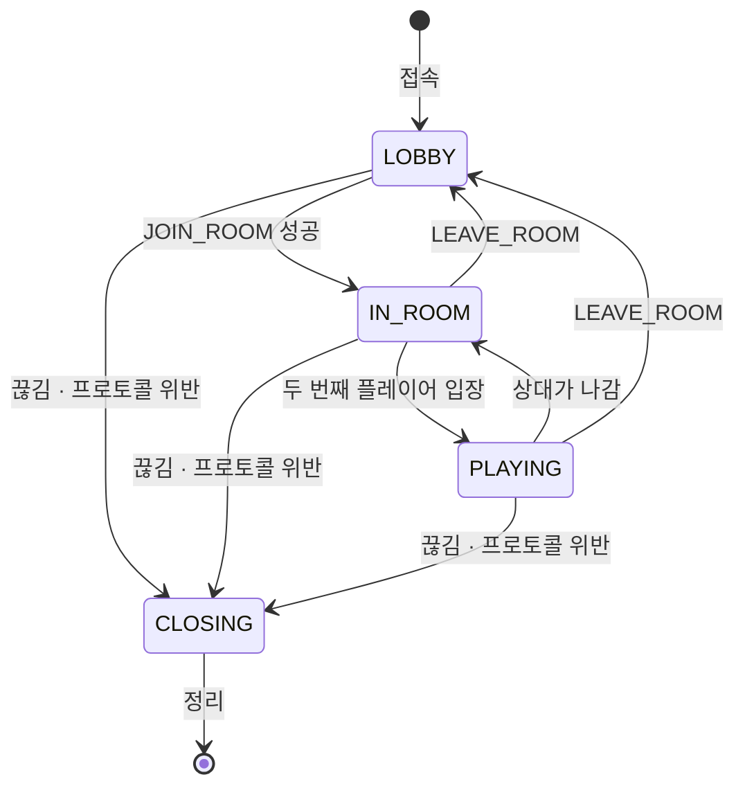

# 시스템 개요

> 상태: 초안 (2026-11-20). 이 문서는 무엇을 왜 만드는지와 큰 구조를 정한다. 바이트 단위 규칙은 [protocol.md](protocol.md)(작성 예정)가, 되돌리기 어려운 결정의 근거는 [adr/](adr/)(작성 예정)가 맡는다.

## 1. 무엇을 만드는가

C로 작성한 리눅스 게임 서버 하나와, 그 서버에 접속해 2인 대전을 하는 Unity Pong 클라이언트.

서버는 두 가지 일을 한다.

1. **릴레이(방 단위 중계)**: 접속한 클라이언트를 방(Room)으로 묶고, 방 안의 플레이어끼리만 메시지가 오가게 한다.
2. **권위적 시뮬레이션**: 방마다 Pong 경기를 서버가 고정 틱(30Hz)으로 계산하고, 그 결과(스냅샷)를 방의 두 플레이어에게 보낸다. 클라이언트는 입력만 보내고, 공 위치와 점수는 서버가 정한다.

## 2. 왜 만드는가

- 소켓, epoll 이벤트 루프, 바이너리 패킷 처리를 외부 네트워크 라이브러리 없이 바닥부터 구현한다(README의 의존성 원칙).
- 만든 서버가 실제로 쓸 만한지 숫자로 보인다: 동시 접속 수, 틱 유지, 지연 분포.
- 코드는 AI가 작성하고, 사람은 설계 결정 · 검증 · 측정 해석을 맡는다. 단계마다 자동 테스트와 직접 플레이로 결과를 확인한다.

## 3. 목표 · 비목표 · 반목표

**목표**

- Unity 클라이언트 두 개가 서버를 거쳐 끝까지 Pong 한 판을 할 수 있다(서로 다른 네트워크에서도).
- 방 여러 개가 동시에 진행된다.
- 깨진 패킷, 갑작스러운 끊김, 읽지 않는 클라이언트가 와도 서버가 죽지 않는다.
- 부하 테스트로 처리 한계와 지연(p50/p95/p99)을 측정해 보고서로 남긴다.

**비목표** (이번 범위에서 하지 않는다)

- 매치메이킹, 로그인, 계정, 랭킹
- UDP 전송, NAT 통과
- 여러 서버로 확장(샤딩, 로드 밸런싱)
- 지연 보상(lag compensation)

**반목표** (동작하더라도 실패로 본다)

- 구조체를 통째로 `send`하는 등 플랫폼에 따라 결과가 달라지는 직렬화
- 같은 PC에서만 동작하는 구현(메시지가 쪼개지거나 붙어서 오면 깨지는 수신 코드)
- 읽지 않는 클라이언트 하나가 서버 메모리를 끝없이 늘리는 구조
- 측정 조건 없이 적은 성능 수치

## 4. 전체 구성



| 구성 요소 | 위치 | 언어 · 환경 |
|---|---|---|
| 릴레이 서버 | `server/` | C11, Linux(epoll). 외부 라이브러리는 uthash만 |
| Unity 클라이언트 | `client-unity/` | Unity 6000.3.10f1, C# `System.Net.Sockets` |
| 더미 클라이언트, 측정 도구 | `tools/` | C11 |
| 테스트 | `tests/` | C11 단위 테스트, 서버를 띄워서 하는 통합 테스트 |
| 문서 | `docs/` | 이 문서, protocol.md, adr/, report.md |

## 5. 핵심 결정

| 결정 | 선택 | 이유 | 기록 |
|---|---|---|---|
| 전송 계층 | TCP + `TCP_NODELAY` | 학습 자료와 1–2단계 구현이 TCP 기준이다. UDP는 재전송 · 세션 · 순서 처리를 새로 만들어야 해서 일정 안에 넣기 어렵다. 손실 환경에서의 꼬리 지연(07 예제: 5% 손실에서 p95 69ms → 216ms)은 대가로 받아들이고 보고서에 적는다 | `adr/0001-transport.md` |
| 동기화 모델 | 권위적 서버 + 스냅샷 전송 | README의 "권위적 상태 동기화" 목표. 클라이언트가 공 위치를 정하지 못하므로 두 화면의 결과가 갈라지지 않는다 | `adr/0002-authority.md` |
| 틱레이트 | 30Hz | Pong에는 충분하고, 2인 방의 메시지량(초당 약 120개)이 작다. 측정 후 바꿀 수 있다 | protocol.md |
| 좌표 표현 | 정수(경기장 단위 좌표) | C와 C#의 계산 결과가 정확히 같아진다. `float`는 컴파일러 · CPU마다 미세하게 달라질 수 있다 | protocol.md |
| 직렬화 | 길이 접두사 프레임, 필드 단위 big-endian | 메시지 경계를 되찾고, 언어 · 플랫폼과 무관하게 같은 바이트가 된다 | protocol.md |
| 이벤트 루프 | 스레드 1개, epoll 레벨 트리거 | 동기화(락)가 없고, 디버깅이 쉽다. 목표 규모(동시 접속 1,000명대)에 충분하다 | 이 문서 |

## 6. 서버 내부 구조

### 6.1 모듈

| 모듈 | 하는 일 |
|---|---|
| `main` | 인자 처리(`--port`), 시그널, 메인 루프 |
| `net` | 리스닝 소켓 생성, 소켓 옵션(`SO_REUSEADDR`, `TCP_NODELAY`, `O_NONBLOCK`) |
| `conn` | 연결 테이블, 연결별 수신 버퍼와 송신 버퍼, 송신 버퍼 상한, 끊긴 연결의 지연 정리 |
| `loop` | epoll 등록 · 대기 · 이벤트 분배, `EPOLLOUT` 켜고 끄기 |
| `wire` / `frame` | 정수 읽기 · 쓰기, 프레임 파서(누적 버퍼에서 완성된 프레임만 꺼냄), 메시지 인코더 |
| `session` | 연결 상태 기계(로비 → 방 → 경기 중 → 종료), 상태별 허용 메시지 검사 |
| `room` | 방 목록(uthash, `room_id → room`), 입장 · 퇴장, 빈 방 해제 |
| `pong` | 한 틱 진행(패들 이동 → 공 이동 → 충돌 → 득점), 순수 함수에 가깝게 유지해 단위 테스트한다 |
| `tick` | 단조 시계(`CLOCK_MONOTONIC`), 누산기, 한 번에 따라잡는 틱 수 상한 |
| `stats` | 틱 처리 시간, 버린 틱, 접속 수, 송수신 바이트 집계 |

### 6.2 메인 루프



- 입력 처리와 시뮬레이션을 분리한다. 입력이 몇 개 오든 시뮬레이션은 틱마다 한 번이다.
- 끊긴 연결은 바로 해제하지 않고 반복의 마지막에 정리한다. 같은 반복 안에서 상대에게 스냅샷을 넣다가 해제된 메모리를 건드리는 것을 막는다.

### 6.3 연결 상태



상태별로 받을 수 있는 메시지와 위반 시 처리(ERROR 응답 또는 연결 종료)는 protocol.md에 표로 정한다.

### 6.4 자원 상한 (기본값, 측정 후 조정)

| 항목 | 기본값 | 넘으면 |
|---|---|---|
| 프레임 페이로드 최대 길이 | 512바이트 | 헤더를 읽는 즉시 연결 종료 |
| 연결당 수신 버퍼 | 2KB | 위와 같음(최대 프레임보다 크게 잡는다) |
| 연결당 송신 버퍼 | 64KB(스냅샷 약 30초 분량) | 느린 클라이언트로 보고 연결 종료 |
| 동시 접속 | `ulimit -n` 범위 안 | 새 접속을 받자마자 닫음 |
| 방당 인원 | 2명 | ERROR(방이 꽉 참) |
| 무입력 시간 | 정하지 않음(TCP 끊김 감지에 맡김) | 필요해지면 protocol.md에 추가 |

## 7. 클라이언트 동작

- **수신**: 백그라운드 스레드가 소켓에서 바이트를 받아 프레임으로 자르고, 메시지를 스레드 안전 큐에 넣는다. Unity 메인 스레드는 `Update`에서 큐를 비운다. Unity API는 메인 스레드에서만 부른다.
- **입력**: 패들 방향(정지 · 위 · 아래)이 바뀔 때와 일정 주기마다 INPUT을 보낸다. 입력마다 증가하는 번호(`input_seq`)를 붙인다.
- **표시**: 받은 스냅샷을 버퍼에 쌓고, 현재 시각보다 약 100ms 과거 시점을 두 스냅샷 사이에서 보간해 그린다(07 문서의 보간 방식).
- **예측 · 재조정**: 일정이 남으면 내 패들만 예측한다. 이를 위해 스냅샷에 "서버가 마지막으로 처리한 내 입력 번호"를 넣을지 protocol.md에서 정한다.

## 8. 검증 방법

| 단계 | 무엇으로 확인하나 |
|---|---|
| 모듈 | 단위 테스트: 프레임 파서(1바이트 조각 · 무작위 조각 · 거부 케이스), pong 한 틱, 방 입장 · 퇴장 |
| 서버 전체 | 통합 테스트: 서버를 띄우고 더미 클라이언트 2개가 같은 방에 들어가 **같은 스냅샷을 받는지**, 한쪽이 끊기면 상대가 IN_ROOM으로 돌아가는지 |
| 견고성 | 무작위 바이트 · 잘못된 헤더 · 읽지 않는 클라이언트 · 강제 종료를 넣어도 서버가 살아 있고 메모리가 늘지 않는지 |
| 메모리 | 모든 테스트를 AddressSanitizer/UBSan 빌드로 돌려 보고 0 |
| 데모 | 사람이 Unity 창 두 개로 직접 플레이 |
| 성능 | 더미 클라이언트로 접속 수를 늘리며 틱 처리 시간, 버린 틱, RTT 분포를 기록 |

빌드와 테스트는 Docker의 `gcc:14` 이미지에서 돌린다(Windows에서 epoll을 쓸 수 없기 때문).

```powershell
docker run --rm -v "C:/GitHub/Relay Server Practice:/src" -w /src gcc:14 sh -c 'make clean all && make test'
```

## 9. 측정 계획

- **환경**: 개발 PC의 Docker(같은 기계), Oracle Cloud Always Free Micro 인스턴스(VM.Standard.E2.1.Micro, 1/8 OCPU 기본 + 버스트, 메모리 1GB, 인터넷 대역폭 최대 50Mbps).
- **지표**: 동시 접속 수별 틱 처리 시간(p50/p95/p99/최대), 버린 틱 수, 입력부터 그 입력이 반영된 스냅샷 수신까지의 시간 분포, 서버 메모리.
- **기록 원칙**: 모든 수치에 표본 수, 측정 시간, 환경(기계, 빌드 옵션, 같은 기계 여부)을 같이 적는다.
- **임시 목표**: 동시 접속 1,000명(방 500개)에서 30Hz 유지, 버린 틱 0. Micro의 CPU가 작아서 이 목표는 첫 측정 후 다시 정한다.

## 10. 일정 (2026-11-20 기준, 마감 12-06까지 16일)

| 기간 | 할 일 | 끝났다는 기준 |
|---|---|---|
| 11/21 | protocol.md, `server/` 뼈대, Makefile | 서버가 뜨고 접속을 받는다. protocol.md 승인 |
| 11/22–11/24 | 서버: 이벤트 루프, 프레임, 방, 틱, Pong | 더미 클라이언트 2개 통합 테스트 통과, ASan 보고 0 |
| 11/25–11/28 | Unity 클라이언트: 접속, 입장, 입력, 보간 표시 | 창 두 개로 대전이 된다 |
| 11/29–11/30 | 견고성: 끊김, 송신 버퍼 상한, 깨진 패킷 | 견고성 테스트 통과 |
| 12/01–12/04 | Micro 배포, 부하 테스트, report.md | 다른 네트워크에서 플레이, 측정 표 |
| 12/05–12/06 | 여유분, 발표 준비 | v1.0 |

**밀릴 때 버리는 순서**: 클라이언트 예측 → 보간(받은 스냅샷을 그대로 그림) → 부하 테스트 규모 축소.

## 11. 남은 결정

| 항목 | 정할 곳 | 정하는 사람 |
|---|---|---|
| 메시지 목록, 필드, 오류 코드, 경기장 크기 · 속도 같은 Pong 규칙 수치 | protocol.md | AI 초안 → 사람 승인 |
| 방 번호를 누가 정하는가(클라이언트가 지정 · 서버가 빈 방 배정) | protocol.md | 사람 |
| 데모 서버로 기존 `tetris-relay` Micro를 쓸지 새 Micro를 만들지 | 배포 시점 | 사람 |
